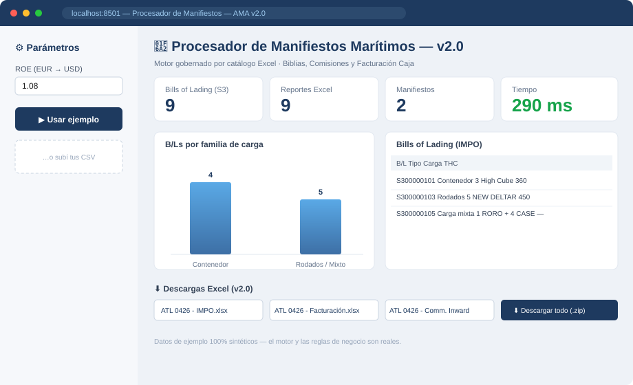
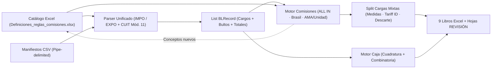

# 🚢 Procesador de Manifiestos Marítimos (v2.0)

> Motor determinístico en Python que procesa manifiestos de carga marítima (`IMPO` / `EXPO`) y genera en **menos de un segundo** las **9 planillas Excel** operativas, contables y de Caja de una agencia marítima — gobernado íntegramente por un catálogo de reglas en Excel y bajo el principio estricto de **nunca inventar valores**.


[](https://github.com/toomastorres/maritime-manifest-processor/actions/workflows/ci.yml)

🔗 **Demo interactiva:** ejecutá `streamlit run streamlit_app.py` localmente o desplegalo en Streamlit Community Cloud.



> ℹ️ **Aviso de confidencialidad y datos sintéticos:** la arquitectura e ingeniería de reglas provienen de un sistema real en producción, pero **todos los datos de este repositorio** —agencia ficticia (*Atlantic Maritime Agency — AMA*), buques, viajes, números de B/L, clientes, CUIT, VIN, alícuotas y tarifas— son **100 % sintéticos e ilustrativos** para portafolio.

---

## El problema operativo

Por cada recalada de buque, una agencia marítima recibe manifiestos con cientos de *Bills of Lading* exportados en tablas `pipe-delimited` de ancho fijo envueltas en CSV, con encabezados de cargos partidos en dos renglones, múltiples monedas (`USD`, `EUR`, `GBP`), cargas mixtas en un mismo B/L y totales repartidos entre origen, destino y subagentes.

Liquidar manualmente cada viaje implicaba horas de cruce propenso a errores humanos para construir las Biblias operativas, liquidar comisiones a Casa Matriz, facturar en Caja validando CUIT y auditar desvíos de tarifas de terminal.

---

## 📈 Evolución del Motor (v1.0 → v2.0): De script ETL a motor gobernado por catálogo

La versión **2.0** representa un salto arquitectónico desde un generador estático de planillas hacia un **motor de liquidación gobernado por datos y auditable**:

1. **Catálogo de Reglas Gobernado en Excel (`Definiciones_reglas_comisiones.xlsx`) con Auto-Descubrimiento (`catalog.py`):**
   - El código ya no codifica qué conceptos suman flete, cuáles son recargos ni qué bultos componen cada familia: lee **84 conceptos de cargo**, **38 tipos de bulto** y **20 puertos de exportación** directamente desde una planilla Excel mantenida por el equipo de negocio mediante listas desplegables (`DataValidation`).
   - **Auto-descubrimiento sin caída (*zero-downtime*):** si un manifiesto futuro introduce un cargo inédito, `register_new_concepts()` lo anexa automáticamente al final de `CONCEPTOS DE CARGO` como gasto neutro con fecha y viaje de hallazgo para revisión posterior, sin sobrescribir reglas existentes.

2. **Regla `ALL IN` (80 %) y Partición Determinística de Cargas Mixtas (`rules/commission.py`, `rules/split.py`):**
   - Evalúa la condición `ALL IN` a nivel de B/L completo (incluyendo la asimetría operativa donde `THC (POD)` es gasto local en `IMPO` pero recargo externo en `EXPO`, y viceversa para `THC (POL)`).
   - Cuando un mismo B/L combina cargas con distinta regla comisionable (ej. `RoRo + Break-Bulk` o `Contenedor + Carga Suelta`), `split.py` adjudica cada línea de flete y de `TOLL` mediante **coincidencia exacta de medidas** (`MT`, `CBM`, `LM`, `20`/`40`, `PU`), agrupación por cotización (`Tariff ID`) o descarte determinístico, abriendo sub-filas limpias sin duplicar totales.

3. **Liquidación para Caja (`Facturación.xlsx`) con CUIT Módulo 11 y Búsqueda Combinatoria (`rules/billing.py`):**
   - Extrae la `CUIT` del Consignee (`IMPO`) o Shipper (`EXPO`) aun cuando viene partida en dos renglones y verifica matemáticamente su **dígito verificador Módulo 11**, descartando falsos positivos documentales.
   - Normaliza cobros de subagentes locales (`Total[Buenos Aires - Partner]`) y, cuando una exportación divide cargos `Prepaid` entre `Buenos Aires` y `Casa Matriz`, ejecuta una **búsqueda combinatoria de suma exacta (`local_lines`)** para aislar qué conceptos componen la factura local — aceptando el resultado únicamente si el subconjunto es **matemáticamente único**.

4. **Principio *"Never Invent Values"* y 8 Categorías Tipadas en `REVISIÓN` (`validation.py`):**
   - Ante cualquier ambigüedad (moneda no convertible como `GBP`, puerto de exportación no catalogado, flete global `1 AA` imposible de repartir entre cargas mixtas o falta de confirmación comercial), el motor **jamás inventa ni prorratea a ojo**: deja la celda de comisión en blanco, resalta la fila y documenta la causa exacta en la hoja `REVISIÓN` bajo 8 categorías accionables (`COMISIÓN - REVISAR`, `CARGA MIXTA`, `LISTA COMERCIAL`, `GASTO LINEA`, `MONEDA`, `CARGA`, `TOTAL MANIFIESTO`, `IMPORTES`).

---

## Qué genera por viaje (9 libros Excel)

| Archivo generado | Destinatario / Contenido principal |
|---|---|
| `<VIAJE> - IMPO.xlsx` | **Biblia de Importación:** hojas `ZARATE`, `BUE`, `TOLL`, `CONTROL DE FLETES` y `REVISIÓN` con fórmulas vivas de Excel y partición de B/L mixtos. |
| `<VIAJE> - Comm. Inward.xlsx` | **Comisiones IMPO:** resumen ejecutivo por puerto y familia (`VEHICLES BOOKED BY AMA`, por unidad, `BBULK`, `CONTAINERS`, `CONTROL EQUIPMENT FEES`) + trazabilidad línea por línea en `DETALLE B-L`. |
| `<VIAJE> - EXPO.xlsx` | **Biblia de Exportación:** liquidación por puerto de carga (`ZTE`/`BUE`), `THC`, `TOLL`, `SWP`, `ENS`, `PREPAID`, `COLLECT` y control cruzado. |
| `<VIAJE> - Comm. Outward.xlsx` | **Comisiones EXPO:** desglose con alícuota general vs regional Brasil, mínimos por contenedor y hoja de auditoría `DETALLE B-L`. |
| `<VIAJE> - Facturación.xlsx` | **Reporte para Caja:** hojas `IMPO`, `EXPO`, `DETALLE IMPO`, `DETALLE EXPO` y `REVISIÓN` con `CUIT` validada (Módulo 11) y conceptos locales conciliados. |
| `<VIAJE> - ENS.xlsx` | **Nota de Débito ENS:** declaración *Entry Summary Declaration* a tarifa ilustrativa fija por B/L alcanzado. |
| `<VIAJE> - PorBL.xlsx` | **Resumen por B/L:** vista consolidada de flete, gastos y unidades por conocimiento. |
| `<VIAJE> - Chasis.xlsx` | **Trazabilidad de VIN:** listado completo de números de chasis de 17 caracteres por B/L y marca. |
| `<VIAJE> - PorMarca.xlsx` | **Resumen Automotriz:** agrupación de volúmenes e importes por marca y agencia *forwarder*. |

---

## Arquitectura del paquete

```text
maritime-manifest-processor/
├── Definiciones_reglas_comisiones.xlsx  # Catálogo gobernado por usuario (conceptos, bultos, puertos)
├── manifest_engine/
│   ├── catalog.py          # Lector cacheado del catálogo Excel + auto-registro de conceptos nuevos
│   ├── config.py           # Parámetros ilustrativos (ROE, tarifas fijas, tasas, flota AMA, marcas)
│   ├── validation.py       # Motor de alertas accionables (capa REVISIÓN sin falsos positivos)
│   ├── __main__.py         # CLI interactivo / batch por carpeta + modo --modelos
│   ├── domain/
│   │   ├── models.py       # Dataclasses tipadas: BLRecord, CargoItem, ChargeLine, TotalLine
│   │   └── classification.py # Resolución de familias, marcas, VIN y sufijos de forwarder
│   ├── parsing/
│   │   └── manifest.py     # Parser unificado IMPO/EXPO, encabezados de 2 líneas y CUIT Módulo 11
│   ├── rules/
│   │   ├── commission.py   # Reglas ALL IN (80%), Brasil, mínimos, rodados AMA/unidad y asignación
│   │   ├── split.py        # Partición determinística de B/L mixtos en sub-filas operativas
│   │   ├── billing.py      # Cuadratura de totales, subagente Partner y combinatoria Prepaid
│   │   └── line_costs.py   # Validación híbrida de THC, TOLL (contenedor/suelto) y Sweeping
│   └── reports/            # Escritores openpyxl estilizados (biblia, comisiones, facturacion, ens, extras)
├── samples/                # Manifiestos CSV 100 % sintéticos (ATL0426 IMPO y EXPO)
├── tools/generate_samples.py # Generador reproducible de manifiestos sintéticos y CUIT Módulo 11
├── tests/test_engine.py    # 22 pruebas automatizadas con pytest (unitarias + extremo a extremo)
└── streamlit_app.py        # Aplicación web interactiva para explorar el motor v2.0
```

### Flujo de datos (v2.0)



---

## Instalación y uso rápido

```bash
# 1) Instalar dependencias
pip install -r requirements.txt

# 2) (Opcional) Regenerar los manifiestos sintéticos de muestra
python tools/generate_samples.py samples

# 3) Procesar un directorio de manifiestos por CLI
python -m manifest_engine samples out

# 4) Generar plantillas vacías de comisiones con fórmulas listas
python -m manifest_engine --modelos out/modelos
```

### Demo interactiva en Streamlit

```bash
streamlit run streamlit_app.py
```

Permite ajustar el **ROE (`EUR → USD`)**, informar la lista de **B/L cerrados por AMA** (o probar `NINGUNO` / modo `ESTIMACIÓN`), inspeccionar tablas de comisiones y alertas `REVISIÓN`, y descargar individualmente o en `.zip` los 9 reportes Excel.

### Suite de pruebas (`pytest`)

```bash
pip install -r requirements-dev.txt
pytest -v
```

Las **22 pruebas** validan la carga del catálogo, el auto-registro idempotente de conceptos sobre copias temporales, el descarte de reposicionamientos `P3`, el dígito verificador Módulo 11 de CUIT, la búsqueda combinatoria de `billing.py` (incluyendo rechazo ante ambigüedad), las reglas `ALL IN` / Brasil / `AMA`, la partición de cargas mixtas y la generación íntegra de los 9 libros `.xlsx`.

---

## Documentación adicional

- [**Guía Técnica (`DOCUMENTACION.md`)**](DOCUMENTACION.md) — diseño interno por módulo, estructuras de datos, invariantes y extensibilidad.
- [**Reglas de Negocio (`reglas_de_negocio.md`)**](reglas_de_negocio.md) — especificación funcional completa de liquidación, comisiones, Caja y criterios de auditoría (con valores ilustrativos).
